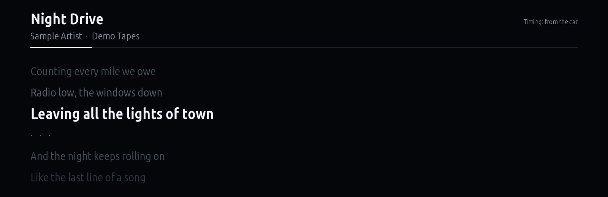
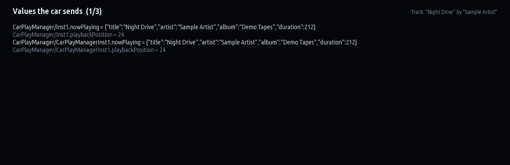

# Car Lyrics

Synced lyrics for whatever the car is playing: Apple Music over CarPlay, Bluetooth or USB. No Spotify
account and no app on the phone.

Version 0.1.1 · iDrive 7 · package `aref_carlyrics` · [all apps and how to install](../../README.md)

> [!WARNING]
> **Experimental.** Which interface and field carry the CarPlay track on iDrive 7 isn't documented. This
> version finds it at run time and doubles as a probe. If the main screen stays on "Play a song on your
> phone", open **Probe** and share what it shows (see below).

## Who it's for

Apple Music listeners. G's Music shows synced lyrics, but it plays through Spotify's Web API and needs
Spotify Premium. Apple offers no API for another device to read or control what an iPhone is playing.
Car Lyrics takes the track from the head unit instead: the car already receives the title and artist
from CarPlay and Bluetooth to show them in its own media screens.

## What it does

- **Main screen:** the song, the artist and album, a progress line, and the lyrics: the current line large,
  the ones around it fading.
- **Lyrics:** from [LRCLIB](https://lrclib.net), a free, open database of synced lyrics. Needs internet
  through the Store's uplink (Wi-Fi or a phone hotspot).
- **Song just started:** when the car doesn't report the playback position, the app times the song from
  when it changes. Tap this to sync it.
- **Lyrics timing** (Settings): moves the lyrics up to 3 s earlier or later.

## Screens

Screens rendered on a PC from the app's own drawing code with made-up data (`tools/screens.js`), not photos of a car.

### Lyrics

The current line large, the ones around it fading. The song and lyrics here are made up.

### Probe

Every value the car sends from the CarPlay and media interfaces.

## The probe

Version 0.1 subscribes to every field of BMW's `CarPlayManager` and `MediaPlayer` interfaces and picks the
track out by field name. The **Probe** screen has three pages:

- **Values the car sends:** every field and its latest value.
- **Media interfaces in the catalog:** interfaces in the unit's SOME/IP catalog whose definitions name a
  title, an artist or now-playing data.
- **Subscriptions:** which interfaces answered.

**Save report** writes all of it to `carlyrics-probe.txt` in the app's data folder; it is also written
every minute. A report from a car playing Apple Music tells the next version exactly which field to use.

## Safety

Read-only toward the car: it subscribes to and reads fields, and never calls a method or writes a value. It
draws only on the centre screen.

## Credits

The lyrics client (`stage/lyrics.js`) is from nickgcode's G's Music (MIT).
