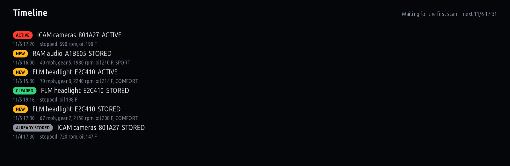
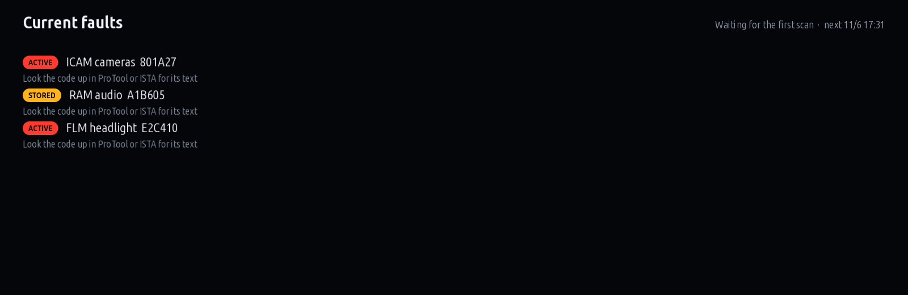
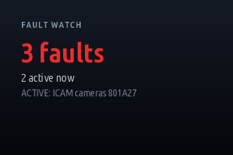

# Fault Watch

Reads every control unit's fault memory in the background while the car is on, and keeps a timeline of
what changed and what the car was doing at the time.

Version 0.2.1 · iDrive 7 · package `aref_faultwatch` · [all apps and how to install](../../README.md)

> [!NOTE]
> Not tested on a car yet. It reads fault memories the same way cauliflowermossgrape's Fault Scanner does
> (UDS `19 02` over the head unit's own diagnostic link).

## Who it's for

Owners chasing an **intermittent** problem: a headlight that drops, audio that cuts out, a camera that
fails now and then, a warning that comes and goes.

A scan tool shows the fault memory at the moment you plug it in. It doesn't show when a fault appeared, or
what the car was doing then, and by the time you scan, the fault may have healed. Fault Watch scans on its
own every few minutes and keeps every change with the time and the drive: speed, gear, rpm, oil
temperature and drive mode. A pattern shows up: always above 60 mph, always cold, always in Sport.

## What it shows

- **Timeline:** every change, newest first:
  - **New:** a fault that wasn't stored at the previous scan.
  - **Active:** a stored fault that is failing right now.
  - **Cleared:** a fault that is gone (cleared, or aged out by the unit).
  - **Already stored:** the faults the very first scan found, before watching began.
- **Current faults:** what the last scan found, per control unit.

Faults show as the code and the control unit's name. Look a code up in ISTA, ProTool or BimmerCode for its
text. A unit that doesn't answer a scan (asleep, busy) keeps its faults: they aren't reported as cleared.

## Screens

Screens rendered on a PC from the app's own drawing code with made-up data (`tools/screens.js`), not photos of a car.

### Timeline

Every change with its time and the drive at that moment.

### Current faults

What the last scan found.

### Home-screen widget

Add it to the iDrive home screen like BMW's own widgets: how many faults are stored, how many are active, and the newest change. The small size shows the same as two lines of text.

## Settings

| Setting | Values | Default |
|---|---|---|
| Scan every | 5, 10, 15, 30 min | 10 min |
| Units | mph and F, km/h and C | mph and F |

The first scan runs about 90 seconds after the car starts, so its units are awake.

## Safety

Read-only. The only request it sends is UDS `19 02` (ReadDTCInformation, report by status mask) to all
units at once, as BMW's testers do. It never clears a fault, never changes a session and never writes.

## Data

Kept in `faultwatch.json` in the app's data folder: the last scan and up to 500 changes. Removing the app
removes it.
